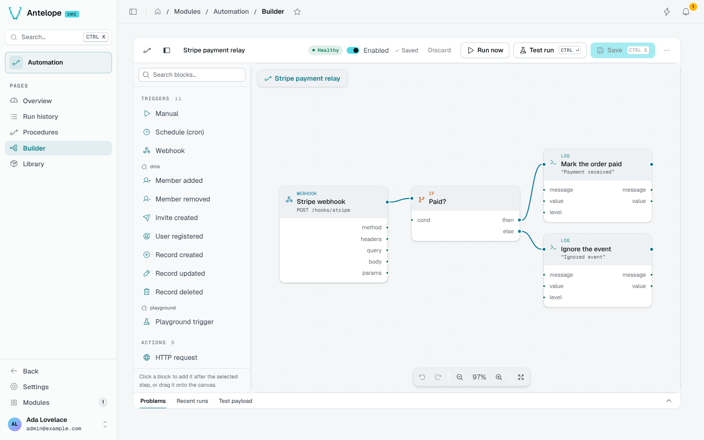

<div align="center">

# @antelopejs/dms-automation

<a href="https://www.npmjs.com/package/@antelopejs/dms-automation"></a>
<a href="./LICENSE"></a>
<a href="https://discord.gg/sjK28QHrA7"></a>
<a href="https://dms.antelopejs.com/docs/modules/automation"></a>

The visual automation builder of the AntelopeJS DMS.

</div>



## What it does

- Builds procedures as node graphs: triggers start a run, actions do the work, flow and data nodes branch, loop and shape values.
- Starts procedures from schedules, webhooks, manual runs or DMS events such as a user registering or a record being created.
- Keeps every run with its trace, shows where and why it failed, and re-runs it with its own payload.
- Shows the health of every procedure, with KPIs over 24 hours, 7 days or 30 days.
- Lets any module add its own nodes through [`@antelopejs/interface-dms-automation`](./packages/interface-dms-automation).

## Install

Run the AntelopeJS CLI from the root of a project that already loads `@antelopejs/dms`:

```bash
ajs project modules add @antelopejs/dms-automation
```

## Quick start

The module works without configuration. Restart the backend, then the frontend, and open **Modules → Automation**. The Overview offers three recipes to start from: **Forward a webhook**, **Send a scheduled digest** and **Run it on demand**.

To add a node from your own module, depend on the interface and register it in `start()`:

```ts
import { RegisterActionType } from "@antelopejs/interface-dms-automation";

RegisterActionType({
  id: "bakery.restock-order",
  name: "Place restock order",
  description: "Order an ingredient restock from a supplier",
  icon: "i-lucide-shopping-cart",
  inputSchema: { type: "object", properties: { ingredient: { type: "string" } } },
  outputSchema: { type: "object", properties: { ordered: { type: "boolean" } } },
  async execute(input, ctx) {
    ctx.log("info", "placing restock order", input);
    return { ordered: true };
  },
});
```

## Compatibility

| Package | Version |
| --- | --- |
| `@antelopejs/dms` | `>=0.9.0 <1.0.0` |
| `@antelopejs/interface-dms` | `>=0.7.0 <1.0.0` |
| `@antelopejs/dms-frontend` (renderer) | `>=0.6.0 <0.7.0` |
| `@antelopejs/interface-dms-automation` | `>=0.2.0 <0.3.0` |
| API provider | `@antelopejs/api`, for webhooks |
| Database | an `@antelopejs/interface-database` implementation |

On DMS 0.8, use `@antelopejs/dms-automation` 0.3. Running several instances needs `@antelopejs/interface-redis`: see [Clustering](https://dms.antelopejs.com/docs/modules/automation/configuration#clustering).

## Packages

| Package | Directory | Role |
| --- | --- | --- |
| [`@antelopejs/dms-automation`](https://www.npmjs.com/package/@antelopejs/dms-automation) | [`packages/dms-automation`](./packages/dms-automation) | The module: procedure editor, runtime, triggers, actions and data nodes. |
| [`@antelopejs/interface-dms-automation`](https://www.npmjs.com/package/@antelopejs/interface-dms-automation) | [`packages/interface-dms-automation`](./packages/interface-dms-automation) | The contract modules depend on to declare their own nodes. |

## Documentation

- [Consumer reference](./packages/interface-dms-automation/docs/1.index.md)
- [Introduction](https://dms.antelopejs.com/docs/modules/automation/introduction)
- [Installation](https://dms.antelopejs.com/docs/modules/automation/installation)
- [Configuration](https://dms.antelopejs.com/docs/modules/automation/configuration)
- [Usage](https://dms.antelopejs.com/docs/modules/automation/usage/overview)
- [Extending](https://dms.antelopejs.com/docs/modules/automation/extending)
- [FAQ](https://dms.antelopejs.com/docs/modules/automation/faq)

The guide's sources live in [`packages/dms-automation/docs`](./packages/dms-automation/docs). The module ships the `dms-automation` Claude Code skill in [`packages/dms-automation/skills`](./packages/dms-automation/skills), declared under `antelopeJs.skills`.

## Contributing

Read [CONTRIBUTING.md](./CONTRIBUTING.md) before opening a pull request. One root install covers the shared tooling, backend, interface and Vue development dependencies, retaining each project's lockfile. The playground remains independent and needs its own install. Root build and typecheck commands cover only the backend and interface; frontend checks require the generated Inertia workspace described below.

```bash
pnpm install
pnpm --dir packages/dms-automation/playground install --ignore-workspace
pnpm build                                        # interface first, then the module
pnpm --dir packages/dms-automation dev            # playground backend
pnpm --dir packages/dms-automation frontend:dev   # dashboard, in a second terminal
pnpm lint
pnpm typecheck
pnpm --dir packages/dms-automation test
```

<details>
<summary>Repository notes</summary>

- A module that only declares nodes depends on the interface package alone, never on the implementation. The module implements the interface, so it depends on it through `>=<interface version> <0.<minor + 1>.0`: a breaking interface minor never reaches a module that does not implement it. pnpm resolves that range to the workspace sibling during development.
- Each package has its own manually dispatched workflow: run **Release DMS automation interface** first, then **Release DMS automation module**, which refuses to start until the interface version its dependency range is floored at resolves on npm.
- The module registers `frontend-vue` through `AddFrontendModule` with the Vue 3 renderer. `dms.frontend.ts` declares the `DmsAutomation` component prefix, registers the Automation components, and a universal plugin registering the `automation:last-runs` cell display of the procedures table. `dms.frontend.build.ts` auto-imports `app/composables` and `app/utils`.
- To build or typecheck the frontend module directly, set `DMS_FRONTEND_WORKSPACE` to the absolute path of a generated Inertia workspace, then run `pnpm --dir packages/dms-automation/frontend-vue build` or `typecheck`. `pnpm --dir packages/dms-automation test:frontend-registration` checks backend registration and configuration without starting database services or triggers.

</details>

## License

[Apache-2.0](./LICENSE)
