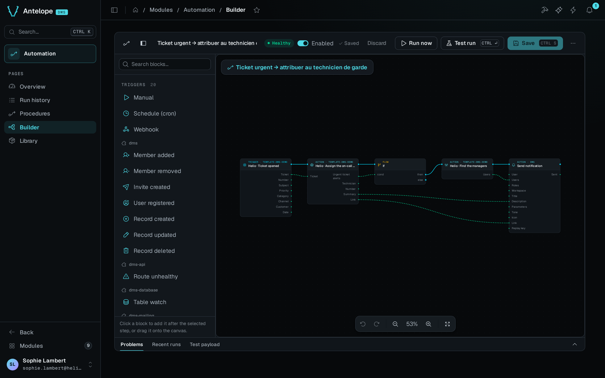

<div align="center">

# `@antelopejs/dms-automation`

<a href="https://www.npmjs.com/package/@antelopejs/dms-automation"></a>
<a href="./LICENSE"></a>
<a href="https://discord.gg/sjK28QHrA7"></a>
<a href="https://dms.antelopejs.com/docs/modules/automation"></a>

The visual automation builder of the AntelopeJS DMS.

</div>



## What it does

- Builds procedures as node graphs. Triggers start a run, actions do the work, and flow and data nodes branch, loop and shape values.
- Starts procedures from schedules, webhooks, manual runs or DMS events such as a user registering or a record being created.
- Keeps every run with its trace, shows where and why it failed, and re-runs it with its own payload.
- Shows the health of every procedure, with KPIs over the last 24 hours, 7 days or 30 days.
- Lets any module add its own nodes, and ship its own procedures as code, through [`@antelopejs/interface-dms-automation`](./packages/interface-dms-automation).

## Install

Run the AntelopeJS CLI from the root of a project that already loads `@antelopejs/dms`:

```bash
ajs project modules add @antelopejs/dms-automation
```

## Quick start

The module works without configuration. Restart the backend, then the frontend, and open **Automation** in the **Modules** group. While no procedure exists, the Overview offers three recipes to start from: **Forward a webhook**, **Send a scheduled digest** and **Run it on demand**.

To add a node from your own module, depend on the interface and register the node in `start()`:

```ts
import { RegisterActionType } from "@antelopejs/interface-dms-automation";

RegisterActionType({
  id: "bakery.restock-order",
  name: "Place restock order",
  description: "Order an ingredient restock from a supplier",
  icon: "i-lucide-shopping-cart",
  inputSchema: { type: "object", properties: { ingredient: { type: "string" } } },
  outputSchema: { type: "object", properties: { ordered: { type: "boolean" } } },
  async execute(input: { ingredient?: string }, ctx) {
    ctx.log("info", "placing restock order", input);
    return { ordered: true };
  },
});
```

## Compatibility

The [module README compatibility block](packages/dms-automation/README.md#compatibility) lists the ranges the module supports, including the `@antelopejs/interface-dms-automation` range it implements and the `@antelopejs/interface-dms` range a DMS backend has to implement. The module also needs these:

- The `@antelopejs/dms-frontend` renderer in the range that `engines["@antelopejs/dms-frontend"]` of `packages/dms-automation/frontend-vue/package.json` declares. The `ajs dms` CLI refuses to build the module with a renderer outside that range.
- An API provider, `@antelopejs/api`, for webhooks.
- An `@antelopejs/interface-database` implementation.
- `@antelopejs/interface-redis`, only to run several instances. See [Clustering](https://dms.antelopejs.com/docs/modules/automation/configuration#clustering).

## Packages

| Package | Directory | Role |
| --- | --- | --- |
| [`@antelopejs/dms-automation`](https://www.npmjs.com/package/@antelopejs/dms-automation) | [`packages/dms-automation`](./packages/dms-automation) | The module: procedure editor, runtime, triggers, actions and data nodes. |
| [`@antelopejs/interface-dms-automation`](https://www.npmjs.com/package/@antelopejs/interface-dms-automation) | [`packages/interface-dms-automation`](./packages/interface-dms-automation) | The contract modules depend on to declare their own nodes. |

## Documentation

- [Consumer reference](./packages/interface-dms-automation/docs/1.index.md)
- [Introduction](https://dms.antelopejs.com/docs/modules/automation/introduction)
- [Installation](https://dms.antelopejs.com/docs/modules/automation/installation)
- [Configuration](https://dms.antelopejs.com/docs/modules/automation/configuration)
- [Usage](https://dms.antelopejs.com/docs/modules/automation/usage/overview)
- [Extending](https://dms.antelopejs.com/docs/modules/automation/extending)
- [FAQ](https://dms.antelopejs.com/docs/modules/automation/faq)

The sources of the guide are in [`packages/dms-automation/docs`](./packages/dms-automation/docs). The module ships the `dms-automation` Claude Code skill in [`packages/dms-automation/skills`](./packages/dms-automation/skills), declared under `antelopeJs.skills`.

## Contributing

Read [CONTRIBUTING.md](./CONTRIBUTING.md) before you open a pull request. One root install covers the shared tooling and the development dependencies of the backend, the interface and the Vue frontend. Each project keeps its own lockfile. The playground is outside the workspace and needs its own install. The root `build` and `typecheck` scripts cover only the backend and the interface. The frontend checks need the generated Inertia workspace that the repository notes below describe.

```bash
pnpm install
pnpm --dir packages/dms-automation/playground install --ignore-workspace
pnpm build                                        # interface first, then the module
pnpm --dir packages/dms-automation dev            # playground backend
pnpm --dir packages/dms-automation frontend:dev   # dashboard, in a second terminal
pnpm run checks                                   # typecheck, lint, format, knip, tests, size, suppressions, sync
```

<details>
<summary>Repository notes</summary>

- A module that only declares nodes depends on the interface package alone, never on the implementation. The module implements the interface, so it depends on the interface through `>=<interface version> <0.<minor + 1>.0`. A breaking interface minor never reaches a module that does not implement it. During development, pnpm resolves that range to the workspace sibling.
- Each package has its own manually dispatched release workflow. Run **Release DMS automation interface** first, then **Release DMS automation module**. The module workflow refuses to start until npm has the interface version that the module's dependency range is floored at.
- The module registers `frontend-vue` through `AddFrontendModule` with the `vue` renderer. `dms.frontend.ts` declares the `DmsAutomation` component prefix and registers the Automation components. It also registers a universal plugin that adds the `automation:last-runs` and `automation:procedure-link` cell displays of the procedures table. `dms.frontend.build.ts` auto-imports `app/composables` and `app/utils`.
- To build or typecheck the frontend module directly, set `DMS_FRONTEND_WORKSPACE` to the absolute path of a generated Inertia workspace. Then run `pnpm --dir packages/dms-automation/frontend-vue build` or `typecheck`. `pnpm --dir packages/dms-automation test:frontend-registration` checks the backend registration and configuration without starting database services or triggers.

</details>

## License

[Apache-2.0](./LICENSE)
