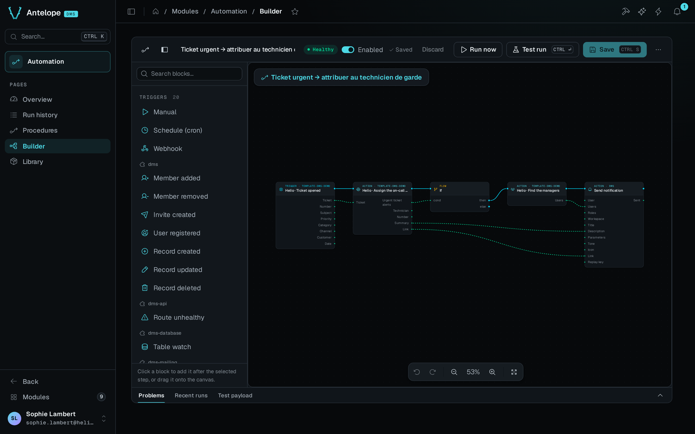

<div align="center">

# `@antelopejs/dms-automation`

<a href="https://www.npmjs.com/package/@antelopejs/dms-automation"></a>
<a href="./LICENSE"></a>
<a href="https://discord.gg/g4pFt6eXqu"></a>
<a href="https://dms.antelopejs.com/docs/modules/automation"></a>

The visual automation builder of the AntelopeJS DMS.

</div>



## What it does

- Builds procedures as node graphs. Triggers start a run, actions do the work, and flow and data nodes branch, loop and shape values.
- Starts procedures from schedules, webhooks, manual runs or DMS events such as a user registering or a record being created.
- Keeps every run with its trace, shows where and why it failed, and re-runs it with its own payload.
- Shows the health of every procedure, with KPIs over the last 24 hours, 7 days or 30 days.
- Lets any module add its own nodes through [`@antelopejs/interface-dms-automation`](https://github.com/AntelopeJS/dms-automation/tree/main/packages/interface-dms-automation).

## Install

Run the AntelopeJS CLI from the root of a project that already loads `@antelopejs/dms`:

```bash
ajs project modules add @antelopejs/dms-automation
```

## Quick start

The module works without configuration. Restart the backend, then the frontend, and open **Automation** in the **Modules** group. While no procedure exists, the Overview offers three recipes to start from: **Forward a webhook**, **Send a scheduled digest** and **Run it on demand**.

To add a node from your own module, depend on the interface and register the node in `start()`:

```ts
import { RegisterActionType } from "@antelopejs/interface-dms-automation";

RegisterActionType({
  id: "bakery.restock-order",
  name: "Place restock order",
  description: "Order an ingredient restock from a supplier",
  icon: "i-lucide-shopping-cart",
  inputSchema: { type: "object", properties: { ingredient: { type: "string" } } },
  outputSchema: { type: "object", properties: { ordered: { type: "boolean" } } },
  async execute(input: { ingredient?: string }, ctx) {
    ctx.log("info", "placing restock order", input);
    return { ordered: true };
  },
});
```

## Compatibility

<!-- antelopejs-docs-compat:start -->

| Package                                     | Supported         | Tested with |
| ------------------------------------------- | ----------------- | ----------- |
| `@antelopejs/interface-api`                 | `>=0.2.0 <1.0.0`  | `0.2.0`     |
| `@antelopejs/interface-api-util`            | `>=0.3.0 <1.0.0`  | `0.3.0`     |
| `@antelopejs/interface-core`                | `>=0.4.0 <1.0.0`  | `0.4.0`     |
| `@antelopejs/interface-data-api`            | `>=0.6.0 <1.0.0`  | `0.6.0`     |
| `@antelopejs/interface-database`            | `>=0.3.1 <1.0.0`  | `0.3.1`     |
| `@antelopejs/interface-database-decorators` | `>=0.3.1 <1.0.0`  | `0.3.2`     |
| `@antelopejs/interface-dms`                 | `>=0.13.0 <1.0.0` | `0.13.0`    |
| `@antelopejs/interface-dms-automation`      | `>=0.6.1 <0.7.0`  | `workspace` |
| `@antelopejs/interface-redis`               | `>=0.0.9 <1.0.0`  | `0.0.9`     |

<!-- antelopejs-docs-compat:end -->

The `@antelopejs/interface-dms-automation` row is the interface range this release implements. The module also needs these:

- A DMS backend that implements the `@antelopejs/interface-dms` range in the table above.
- The `@antelopejs/dms-frontend` renderer in the range that `engines["@antelopejs/dms-frontend"]` of `frontend-vue/package.json` declares. The `ajs dms` CLI refuses to build the module with a renderer outside that range.
- An API provider, `@antelopejs/api`, for webhooks.
- An `@antelopejs/interface-database` implementation.
- `@antelopejs/interface-redis`, only to run several instances. See [Clustering](https://dms.antelopejs.com/docs/modules/automation/configuration#clustering).

## Documentation

- [Introduction](https://dms.antelopejs.com/docs/modules/automation/introduction)
- [Installation](https://dms.antelopejs.com/docs/modules/automation/installation)
- [Configuration](https://dms.antelopejs.com/docs/modules/automation/configuration)
- [Usage](https://dms.antelopejs.com/docs/modules/automation/usage/overview)
- [Extending](https://dms.antelopejs.com/docs/modules/automation/extending)
- [FAQ](https://dms.antelopejs.com/docs/modules/automation/faq)

The sources of the guide are in [`packages/dms-automation/docs`](https://github.com/AntelopeJS/dms-automation/tree/main/packages/dms-automation/docs). The module ships the `dms-automation` Claude Code skill in [`packages/dms-automation/skills`](https://github.com/AntelopeJS/dms-automation/tree/main/packages/dms-automation/skills), declared under `antelopeJs.skills`.

## Contributing

This package lives in the [`AntelopeJS/dms-automation`](https://github.com/AntelopeJS/dms-automation) pnpm workspace, next to `@antelopejs/interface-dms-automation`. Read [CONTRIBUTING.md](https://github.com/AntelopeJS/dms-automation/blob/main/CONTRIBUTING.md) and the [repository README](https://github.com/AntelopeJS/dms-automation#contributing) for the development commands.

## License

[Apache-2.0](./LICENSE)
