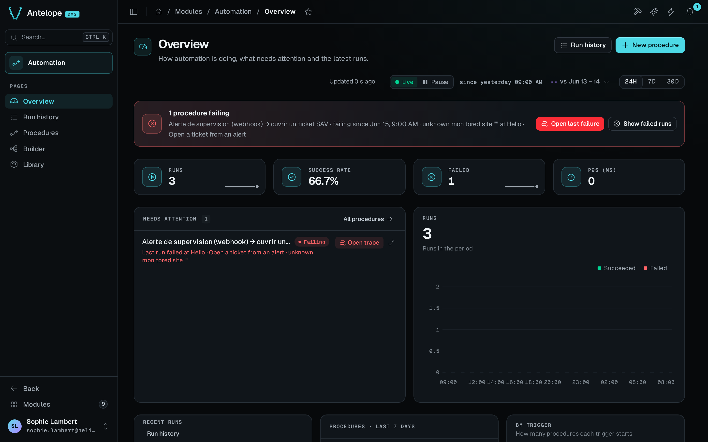

`@antelopejs/dms-automation` is the visual automation builder of the AntelopeJS DMS. A **procedure** is a graph of nodes. A trigger starts it: a schedule, a webhook, a click or a DMS event. Actions do the work, such as an HTTP call, an email or a notification. Data nodes shape the values in between. The module runs procedures, keeps every run with its trace, and tells you which procedures need attention.

## What the module adds to the dashboard

::card-group
  :::card{title="Overview" icon="i-lucide-gauge" to="/docs/modules/automation/usage/overview"}
  The health of every procedure in one line, KPIs over the last 24 hours, 7 days or 30 days, and what needs attention and why.
  :::

  :::card{title="Procedures" icon="i-lucide-workflow" to="/docs/modules/automation/usage/procedures"}
  Every procedure with its state, its last runs, its success rate and its trigger, with the new and import dialogs.
  :::

  :::card{title="Builder" icon="i-lucide-git-fork" to="/docs/modules/automation/usage/builder"}
  The graph editor, with test runs shown on the canvas and problems placed on their nodes.
  :::

  :::card{title="Run history and trace" icon="i-lucide-list-checks" to="/docs/modules/automation/usage/runs"}
  Every run, its steps on a timeline, where and why it failed, and a re-run with its own payload.
  :::

  :::card{title="Library" icon="i-lucide-package" to="/docs/modules/automation/usage/library"}
  Triggers, actions, data nodes and templates, each with the procedures that use it.
  :::
::

## Building blocks

A procedure combines five kinds of blocks. The module ships the triggers **Manual**, **Schedule (cron)** and **Webhook**, the actions **HTTP request** and **Log**, the flow nodes and the data nodes in the table below. The DMS and other modules register the rest.

| Kind | Examples | Role |
| --- | --- | --- |
| Triggers | Manual, Schedule (cron), Webhook, and DMS events such as Member added, User registered and Record created | Start a run with a payload. |
| Actions | HTTP request, Log, Send email, Send notification, Invite user | Do something, in order along trigger edges. |
| Flow | If, Switch, For each, For range, Parallel, Try / Catch, Retry, Delay, Set variable | Branch, loop and recover. |
| Data nodes | Constants, Math, Comparison, Logic, Text, Objects, JSON | Compute values that data edges wire into fields. |
| Templates | Your own reusable groups of nodes | Share a sub-graph between procedures. |

The DMS registers the event triggers and the **Send email**, **Send notification** and **Invite user** actions. Other modules add their own nodes through [`@antelopejs/interface-dms-automation`](/docs/modules/automation/extending). `@antelopejs/dms-database` adds a **Table watch** trigger. `@antelopejs/dms-api` adds a **Route unhealthy** trigger and two actions, **Get API health** and **Query request logs**.

## Who it is for

The Automation pages sit in the DMS **Modules** group, which only the platform owner sees. The module's API follows the same rule: every route answers the platform owner only.

## Requirements

- A DMS backend and the `@antelopejs/dms-frontend` renderer in the ranges the module supports. The compatibility block of the [module README](https://github.com/AntelopeJS/dms-automation/tree/main/packages/dms-automation#compatibility) lists the `@antelopejs/interface-dms` range. The frontend module declares its renderer range in `engines["@antelopejs/dms-frontend"]` of `frontend-vue/package.json`, and the `ajs dms` CLI refuses to build the module with a renderer outside that range.
- An API provider, `@antelopejs/api`, for webhooks.
- A database implementation.
- Optionally, `@antelopejs/interface-redis`, to run several instances. See [Clustering](/docs/modules/automation/configuration#clustering).
