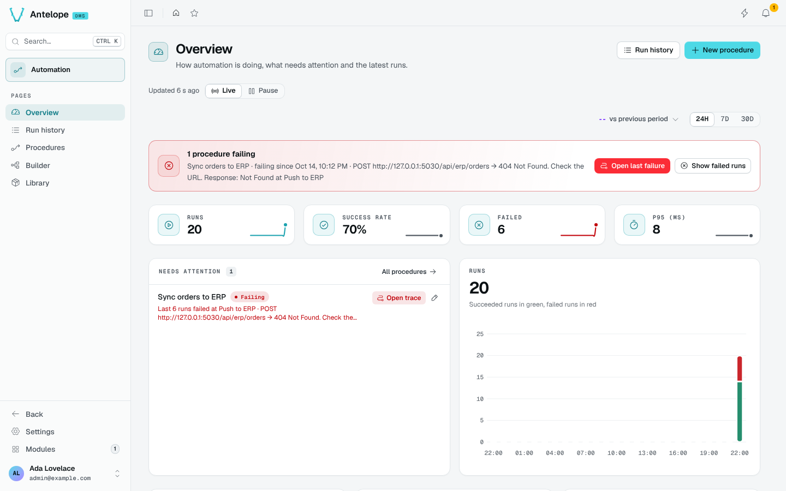

# Introduction

`@antelopejs/dms-automation` is the visual automation builder of the AntelopeJS DMS. A **procedure** is a graph of nodes: a trigger (a schedule, a webhook, a click, a DMS event) starts it, actions do the work (an HTTP call, an e-mail, a notification), and data nodes shape the values in between. The module runs procedures, keeps every run with its trace, and tells you which ones need attention.

## What it brings

::card-group
  :::card{title="Overview" icon="i-lucide-gauge" to="/docs/modules/automation/usage/overview"}
  The health of every procedure in one line, KPIs over 24 h, 7 d or 30 d, what needs attention and why.
  :::

  :::card{title="Procedures" icon="i-lucide-workflow" to="/docs/modules/automation/usage/procedures"}
  Every procedure with its state, its last runs, success rate and trigger; new and import dialogs.
  :::

  :::card{title="Builder" icon="i-lucide-git-fork" to="/docs/modules/automation/usage/builder"}
  The graph editor, with test runs overlaid on the canvas and problems mapped onto nodes.
  :::

  :::card{title="Run history and trace" icon="i-lucide-list-checks" to="/docs/modules/automation/usage/runs"}
  Every run, its steps on a time line, where and why it failed, and a re-run with its own payload.
  :::

  :::card{title="Library" icon="i-lucide-package" to="/docs/modules/automation/usage/library"}
  Triggers, actions, data nodes and templates, each with where it is used.
  :::
::

## Building blocks

| Kind | Examples | Role |
| --- | --- | --- |
| Triggers | Manual, Schedule (cron), Webhook, DMS events (member added, user registered, record created…) | Start a run with a payload. |
| Actions | HTTP request, Log, Send email, Send notification, Invite user | Do something, in order along trigger edges. |
| Flow | If, Switch, For each, For range, Parallel, Try/Catch, Retry, Delay, Set variable | Branch, loop and recover. |
| Data nodes | Constants, math, comparisons, booleans, strings, objects, JSON | Compute values wired into fields along data edges. |
| Templates | Your own reusable groups of nodes | Share a sub-graph between procedures. |

Other modules add their own nodes through [`@antelopejs/interface-dms-automation`](/docs/modules/automation/extending): `@antelopejs/dms-database` adds a **Table watch** trigger, `@antelopejs/dms-api` a **Route unhealthy** trigger and two actions.

## Who it is for

The pages, like every DMS module page, belong to the platform owner, and so does the module's API.

## Requirements

- `@antelopejs/dms` 0.11 or later (`@antelopejs/interface-dms` 0.9 or later) and `@antelopejs/dms-frontend` 0.9. On DMS 0.10, use version 0.6.0 of the module.
- An API provider (`@antelopejs/api`) for webhooks, and a database implementation.
- Optional: `@antelopejs/interface-redis`, to run several instances. See [Clustering](/docs/modules/automation/configuration#clustering).
