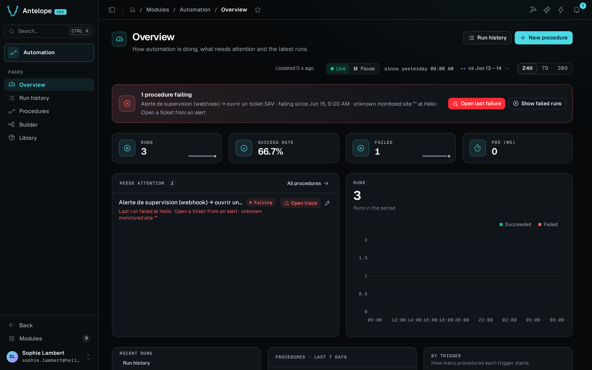

The Overview (`/modules/automation/overview`) shows how automation is doing, what needs attention and what ran last. Its header has two buttons. **Run history** opens the [Run history](/docs/modules/automation/usage/runs), and **New procedure** opens the dialog that creates a procedure.

## Health banner

The banner at the top says in one line how the procedures did over the selected period. Its colour and wording follow the worst state it finds.

| State | Title | Line under it | Buttons |
| --- | --- | --- | --- |
| Failing | **N procedures failing** | The most urgent procedure, since when it fails, and the error of its last failure with the step it failed at. If its trigger could not be armed, the line gives that reason instead. | **Open last failure**, then **Show failing procedures** when more than one procedure fails, else **Show failed runs** when runs failed in the period |
| Degraded | **N procedures degraded** | The runs and failed runs of the period, and how many procedures are enabled | **Open last failure** and **Show failed runs** |
| Healthy | **Every procedure is healthy** | The same counts | **Show failed runs** when runs failed in the period, for example the runs of a procedure paused since, else none |
| Idle | **Nothing ran in this window** | The same counts | None |

**Open last failure** opens the [run trace](/docs/modules/automation/usage/runs#run-trace) of the last failed run. A procedure that fails because its trigger could not be armed has no run to open, so the button is missing. **Show failing procedures** opens the Procedures list on its **Failing** tab. **Show failed runs** opens the Run history on its **Failed** tab, over the same period.

With no procedure yet, the banner shows the recipes instead (see [Start from a recipe](#start-from-a-recipe)).

## Period and run figures

The bar at the top of the page holds the period: **24H**, **7D** or **30D**. The bar says when the window starts. Its comparison menu offers **vs previous period**, the default, and **No comparison**, which hides the changes under the figures. It offers **vs previous year** too when the project keeps runs long enough to reach the same window a year earlier. That takes a `runs.retentionDays` of 395 or more, or `0` to keep every run. The default of 30 days does not reach it. A change shows only when runs from the compared window are still kept. The Run history uses the same period and comparison, so a choice made on one page carries over to the other.

Four cards show the figures of the period, each with a sparkline and its change against the compared window (**vs compared period**):

- **Runs**
- **Success rate**
- **Failed**
- **p95 (ms)**, the 95th percentile of the run duration in milliseconds

The **Runs** chart stacks succeeded runs in green and failed runs in red, one bar per hour on **24H** and one per day on **7D** and **30D**. With a comparison, a dashed line draws the runs of the compared window over the bars, bucket by bucket. The total sits above the chart with its change and the compared total (**vs 120**). The legend names the three series: **Succeeded**, **Failed** and **Runs, compared period**. Without a change to show, the line under the total reads **Runs in the period**.

Test runs started from the builder never count in these figures.

## Needs attention

**Needs attention** lists the procedures that need someone, at most five, with **Show all (N)** linking to the Procedures list when there are more. Failing procedures come first, then degraded ones, then paused ones. Within a state, the longest run of failures comes first.

| State | Line under the name | Actions |
| --- | --- | --- |
| Failing | How many runs in a row failed, at which step and with which error, or why the trigger could not be armed | **Open trace** and **Open in builder** |
| Degraded | How many runs failed in the period, and when the last one did | **Open trace**, **Dismiss** and **Open in builder** |
| Paused | When it was paused, and by whom when that is known | **Resume** and **Open in builder** |

**Dismiss** hides a degraded procedure until its next failure. **Dismiss** and **Resume** both offer **Undo** in the message that confirms them. A failing procedure is listed whatever the period. A degraded one is listed when runs failed within the period. With nothing to list, the card reads **Nothing needs attention**.

## Recent runs, procedures and triggers

The last row of the page holds three cards:

- **Recent runs** lists the last eight runs, each linking to its trace, with a **Run history** link.
- **Procedures · last 7 days** counts the procedures by state (**Total**, then each state), each count linking to the matching tab of the Procedures list.
- **By trigger** shows how many procedures each trigger type starts.

## Live mode

The page follows new runs live, like the other DMS pages with a **Live / Pause** switch. The switch sits in the same bar as the period, next to how long ago the page was updated (**Updated 12 s ago**). Each stored run and each changed procedure makes the page read the figures, the chart and the lists again, at most once every 10 seconds. **Pause** keeps the figures still while you read. Nothing is read while paused, the switch counts what came in, and **Resume** catches up at once.

## Start from a recipe

With no procedure yet, the banner reads **Automate your first procedure** and offers three recipes:

| Recipe | Trigger it places |
| --- | --- |
| **Forward a webhook** | A webhook on `POST /webhooks/<name>`, where `<name>` is the procedure name in lower case with dashes |
| **Send a scheduled digest** | A schedule on `0 9 * * 1`, every Monday at 09:00 |
| **Run it on demand** | A manual trigger, started with **Run now** or from the API |

A recipe opens the **New procedure** dialog with its trigger picked. Name the procedure and choose **Create and open the builder**. The builder opens with the trigger in place. The procedure starts as a disabled draft, so nothing fires until you enable it. **New procedure** in the header opens the same dialog at any time, with **A webhook is called** picked.
