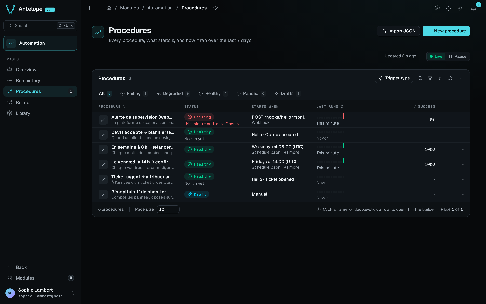

The Procedures page (`/modules/automation/procedures`) lists every procedure, what starts it, and how it ran over the last 7 days.

## States

| State | Meaning |
| --- | --- |
| **Failing** | The procedure is enabled, and its last run failed or its trigger cannot be armed (an invalid schedule, a webhook path already taken). The reason shows under the state. |
| **Degraded** | The procedure is enabled and its last run succeeded, but runs failed in the last 7 days. The count of failed runs shows under the state. |
| **Healthy** | The procedure is enabled, with no failure in the last 7 days. A procedure that never ran is healthy, with **No run yet** under the state. |
| **Paused** | The procedure is disabled after it was enabled or after it ran. |
| **Draft** | The procedure has no trigger, or it is disabled and was never enabled nor run. |

The states move live as runs land and procedures change. The bar at the top of the page says when the list was updated. **Pause** keeps the rows as they stand through a search, a sort or a tab, and **N new · Show** counts the changes since.

Test runs from the builder have a trace but never count in these states.

The tabs **Failing**, **Degraded**, **Healthy**, **Paused** and **Drafts** filter by state and show their counts. The **Trigger type** filter, the search and the column filters narrow the list further.

## Columns

The list shows five columns:

- **Procedure** is the name, with the description under it.
- **Status** is the state, with its reason under it.
- **Starts when** describes the trigger in words, for example *Every hour at :00*, *Weekdays at 08:00 (UTC)*, *POST /hooks/stripe* or *User registered*. Under a webhook or a schedule, the cell names the trigger type. When the procedure has more than one trigger, it also says how many more there are.
- **Last runs** draws the last 12 runs, green or red, with the time of the last one. Each mark opens the trace of its run.
- **Success** is the share of successful runs over the last 7 days.

The column picker adds **Description**, **Last error**, **Enabled**, **Trigger type** and **Avg**, the average run duration.

## Open and act on a procedure

Click a name, or double-click a row, to open the procedure in the [Builder](/docs/modules/automation/usage/builder). The row menu holds these actions:

| Action | What it does |
| --- | --- |
| **Open in builder** | Opens the procedure in the builder. |
| **Run now** | Runs the saved version with the payload of its last real call, or an empty payload if it was never called, after a confirmation. Side effects are real. Drafts do not have it. |
| **Pause** | Disables an enabled procedure. |
| **Resume** | Enables a paused procedure. |
| **Open last run** | Opens the trace of the last run, when there is one. |
| **View runs** | Opens the Run history on this procedure's runs. |
| **Duplicate** | Creates a disabled copy named `<name> (copy)`, its webhooks moved to free paths. |
| **Delete** | Deletes the procedure after a confirmation. |

## Create or import

The page header has two buttons:

- **New procedure** asks for a name, what starts the procedure (**A webhook is called**, **On a schedule** or **I run it**) and an optional description. **Create and open the builder** creates it as a disabled draft and opens the builder with the trigger in place.
- **Import JSON** takes the content of the file that **Export JSON** in the builder downloads. **Import and open the builder** creates it as a disabled draft and opens it in the builder, where **Problems** lists any problem in its graph. JSON that is not an exported procedure, or that uses a kind of step this installation does not have, is refused with the reason.

::warning
Deleting a procedure, from the row menu or the builder's menu, deletes its graph for good. Export JSON from the builder first to keep a copy. When the procedure is enabled, the confirmation says how often it ran this week and suggests **Pause** instead. Its run history stays until retention removes it.
::
