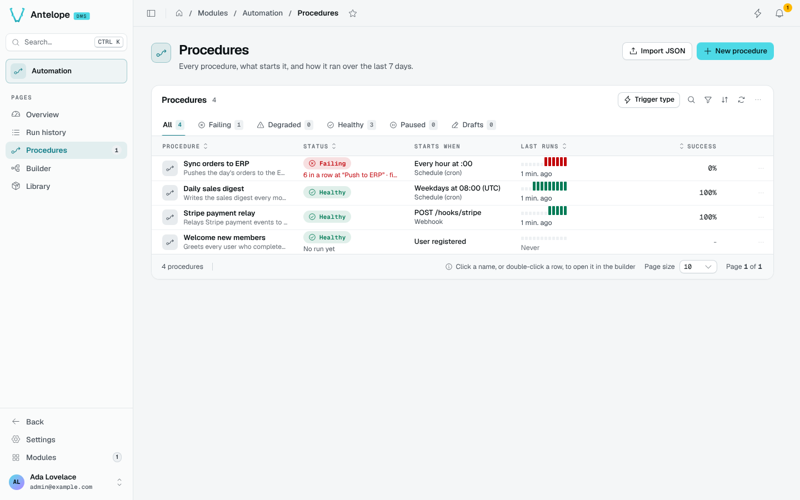

# Procedures

The Procedures page (`/modules/automation/procedures`) lists every procedure, what starts it, and how it ran over the last 7 days.

## States

| State | Meaning |
| --- | --- |
| **Failing** | Its last run failed, or its trigger cannot be armed (an invalid schedule, a webhook path already taken). The reason shows under the state. |
| **Degraded** | Runs failed in the last 7 days, but the last one succeeded. |
| **Healthy** | No failure in the last 7 days. |
| **Paused** | The procedure is disabled. |
| **Draft** | It has no trigger, or was never enabled nor run. |

Test runs from the builder have a trace but never count in these states. The tabs filter by state, with their counts; **Trigger type**, search and filters narrow the list further.

## Columns

- **Starts when** describes the trigger in words: *Every hour at :00*, *Weekdays at 08:00 (UTC)*, *POST /hooks/stripe*, *User registered*.
- **Last runs** draws the last 12 runs, green or red, with the time of the last one.
- **Success** is the share of successful runs.

Click a name, or double-click a row, to open the procedure in the [Builder](/docs/modules/automation/usage/builder). The row menu runs it now, pauses or resumes it, opens its last run or all its runs, and duplicates it (a disabled copy, its webhooks moved to free paths).

## Create or import

- **New procedure** asks for a name and a starter trigger, then opens the builder.
- **Import JSON** takes a procedure exported from the builder (**Export JSON**) and creates it as a disabled draft, listing any problem in its graph.

::warning
Deleting a procedure (from the builder's menu) deletes its graph for good. Export JSON from the builder first to keep a copy. Its run history stays until retention removes it.
::
