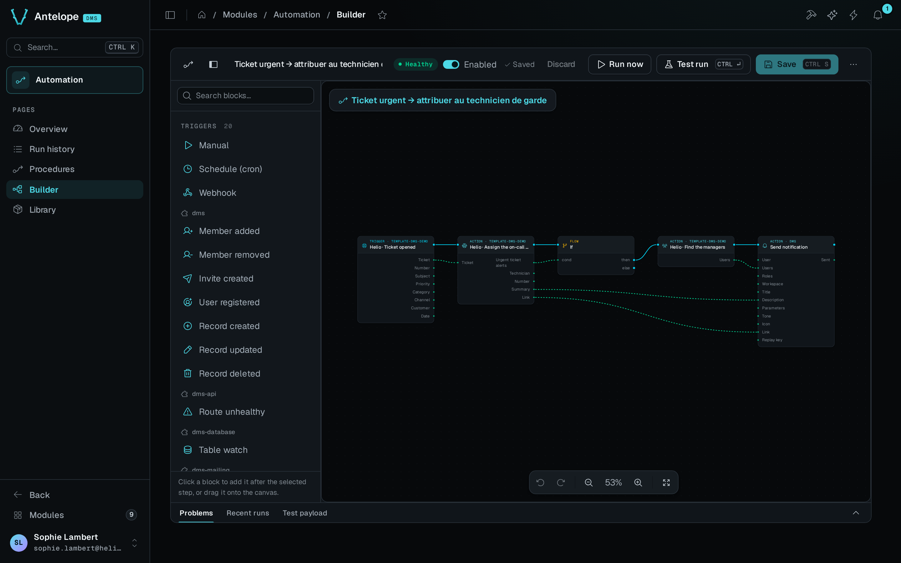
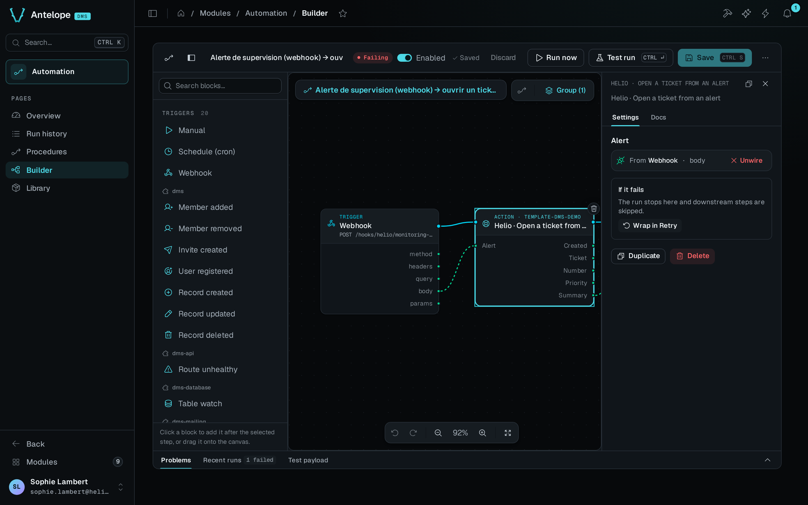
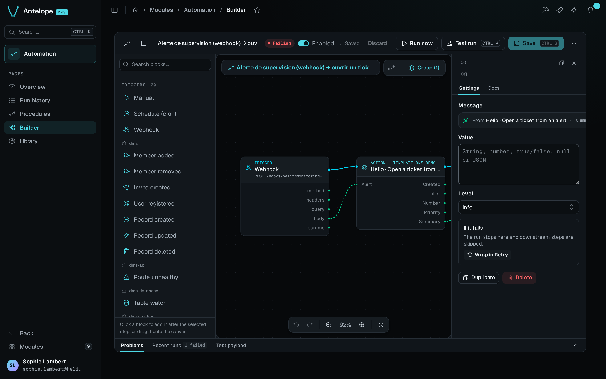
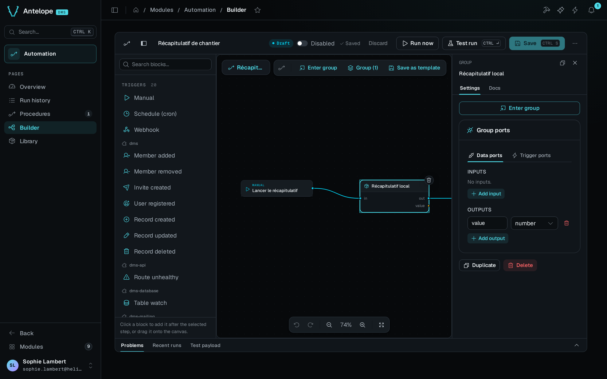
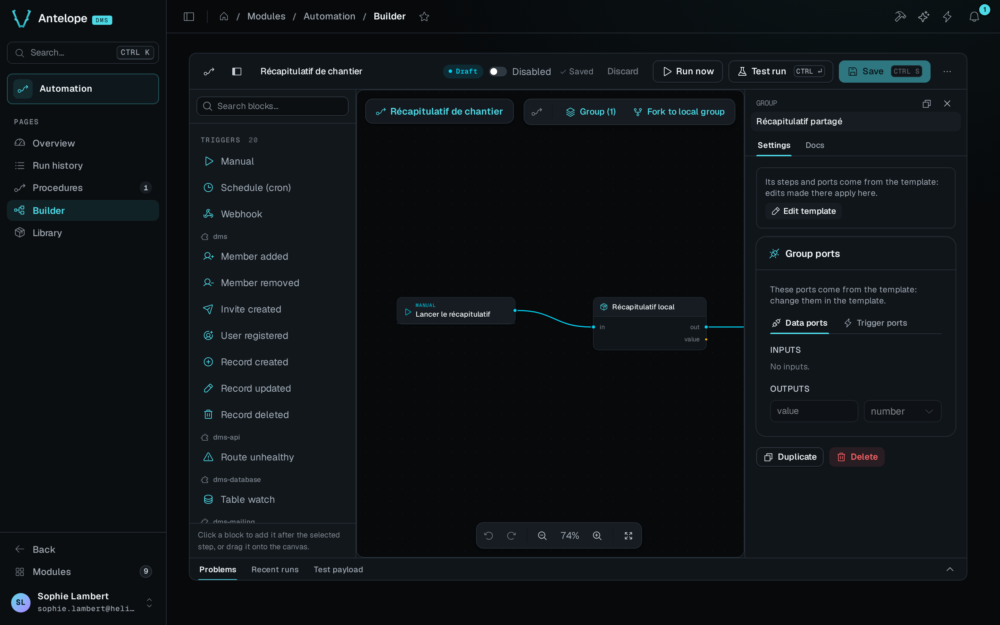

The Builder (`/modules/automation/builder?selected=<procedureId>`) is the graph editor of a procedure. It fills the page and draws its own bar in place of the page header.

## A two-step procedure

The smallest procedure that runs has two nodes from the palette: a **Manual** trigger and a **Log** action. An execution edge joins the trigger's right handle to the Log action's left handle. In the Log action's **Settings**, **Message** holds the text to write, for example `Hello from my first procedure`, and **Level** is `info` by default.

With `{}` as the **Test payload**, **Test run** runs this draft without saving it. The message appears in the **Logs** tab of the run's trace. After **Save**, **Run now** runs the saved version.

Log writes a trace entry and a backend log and calls no external service, so a test runs it as it is. Its message is stored with the run, so it must not hold credentials. Other action types can change real data even during a test (see [Test and run](#test-and-run)).

## Layout

The builder has five areas.

**Bar.** From left to right, the bar holds these controls:

- the procedure switcher (`Ctrl` `P`), and **Show blocks** or **Hide blocks** for the palette
- the procedure's name and state
- the **Enabled** switch and the save state
- **Discard**, **Run now**, **Test run** (`Ctrl` `Enter`) and **Save** (`Ctrl` `S`)
- the **More actions** menu, with **New procedure**, **Export JSON**, **View all runs** and **Delete procedure**

On macOS, `⌘` replaces `Ctrl`.

**Palette.** The palette sits on the left and holds the groups **Triggers**, **Actions**, **Flow**, **Helpers**, **Data** and **Templates**. Inside a group, the built-in blocks come first, then one section per module that registered blocks (`dms`, `playground`, and so on). Built-in data nodes are split by category. **Search blocks…** filters them. Click a block to add it after the selected step, or drag it onto the canvas. A type switched off in the [Library](/docs/modules/automation/usage/library) shows **Off**, and its steps fail when they run.

**Canvas.** The canvas holds the graph. A trigger edge sets the order of the steps and joins the right handle of a step to the left handle of the next one. A data edge joins an output port to an input field. A trigger port (blue) links only to a trigger port, and a data port (green) only to a data port. A port reads as its field's title when the type declares one (a `$` key in the reader's language), else as its key. Hover a titled port to see the key it wires by.

**Inspector.** The inspector sits on the right. It shows the selected node's **Step name**, its **Settings**, generated from its schema, and its **Docs**. When a run is shown on the canvas, a **Last run** tab shows what the step did, titled **This run failed** when it failed. A schedule trigger shows its next run.

**Dock.** The dock sits at the bottom, with the tabs **Problems**, **Recent runs** and **Test payload**. After a test, a **Test run** tab lists the steps that ran.

## Wire values

A field takes a typed value, or a value wired from an earlier step's output. That output can be the trigger's payload (`body`, `headers` and `query` of a webhook), an action's result, or a data node's output. Data nodes (constants, math, logic, comparisons, text, objects and JSON) compute values without side effects.

To wire a value, connect the source's output port to the target's input port. In the Helio monitoring procedure, the **Log** step takes its **Message** from the `summary` output of **Helio · Open a ticket from an alert**. The inspector shows **From Helio · Open a ticket from an alert · summary** instead of a literal input, with **Unwire** to remove the link. The solid execution line sets when the Log action runs. The dashed data line supplies its value.

::tip
Keep credentials out of the graph. Every builder user and every template user sees them. Pass them through your own action types or the project's configuration.
::

## Flow

Flow nodes branch and loop:

| Node | What it does |
| --- | --- |
| **If** | Follows `then` when the condition is true, `else` otherwise. |
| **Switch** | Follows the branch whose case matches the value, or `default`. |
| **For each** | Runs its body once per item of a list. |
| **For range** | Runs its body for each number of a range. |
| **Parallel** | Starts every branch at once and waits for all of them. |
| **Try / Catch** | Runs `try`, and `catch` with the error if it fails. |
| **Retry** | Runs its body up to **Max attempts** times. When every attempt fails, the flow goes on from `exhausted`. |

The **Helpers** group holds **Delay**, which waits a set time, and **Set variable**, which names a value for the next steps. **Wrap in Retry** in the inspector puts a step inside a Retry in one click.

## Groups and templates

Select several steps and choose **Group (N)** to fold them into one node with its own input and output ports. Select the local group to edit its ports under **Group ports**, or choose **Enter group** to work on the steps inside.

**Save as template** makes the group reusable. An instance displays **Linked**. Its steps and ports come from the shared template, so edits made there apply to every procedure that uses it. The instance's port controls are read-only. Choose **Edit template** to change the shared definition, or **Fork to local group** to make a private copy.

## Test and run

- **Test run** runs the draft, unsaved, on the test payload. The **Test payload** is filled from the last real call when there is one. The run is kept with a trace, shown on the canvas, and never counts in the figures. Actions that declare no side effects, such as **Log**, run as usual. Actions whose module declares a dry run are simulated. They return a plausible output and do nothing. When the draft has steps that would act for real, the builder lists them in **Test with real effects?** and starts the test only after **Test for real**. Nothing runs if you cancel.
- **Run now** runs the saved procedure, with an editable payload that defaults to the trigger's last payload. With unsaved changes, the builder first asks whether to run the saved version or to test the draft.
- **Problems** lists what blocks enabling the procedure (a missing required field, a broken edge, a webhook path already taken), each with **Select node** to jump to its node. Saving an enabled procedure with problems is refused, and the builder offers **Save as draft**, which saves it disabled. Nothing fires until the problems are fixed.

::warning
**Run now** runs every action for real. **Test run** simulates only the actions that declare a dry run. The others, such as HTTP requests and any module action without one, send, write and call for real, without rollback, once you confirm the list. Use test services and non-sensitive sample data when your graph has such steps.
::
