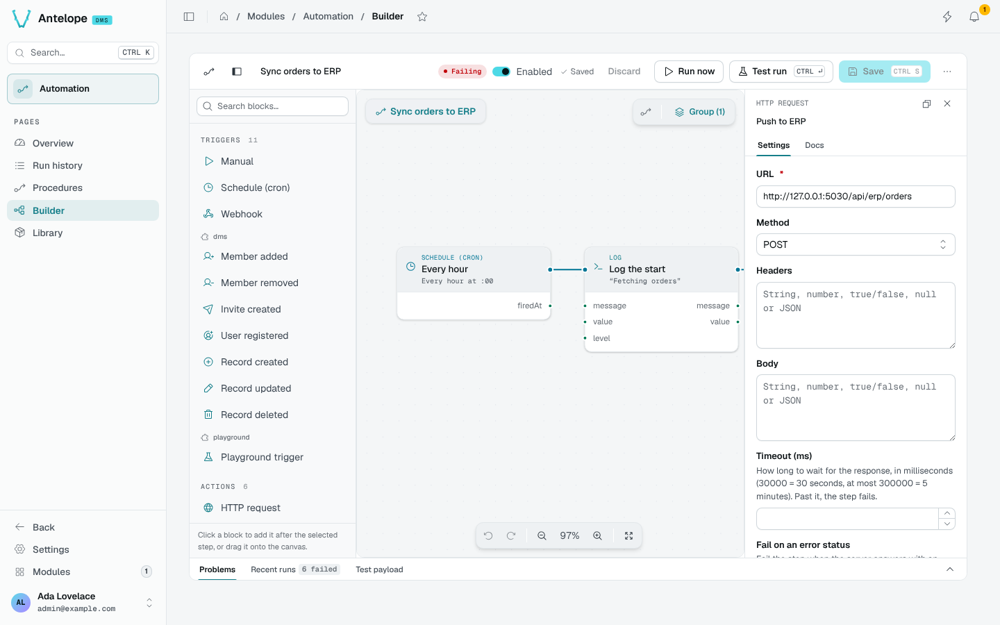
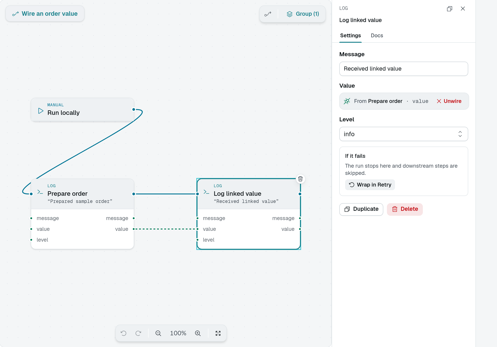
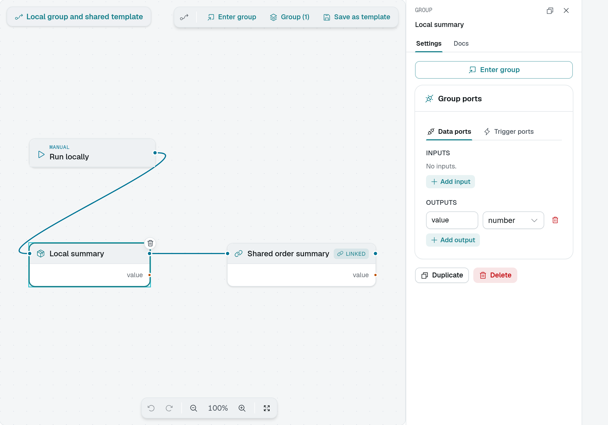
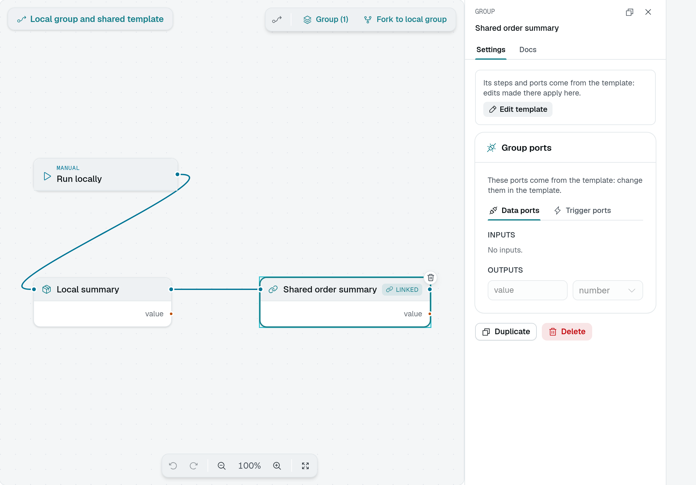

# Builder

The Builder (`/modules/automation/builder?selected=<procedureId>`) is the graph editor of a procedure.

## Try a two-step procedure

Start with a new procedure containing only a **Manual** trigger and a **Log** action:

1. Add the two nodes from the palette. Connect the trigger's right execution handle to the Log action's left handle.
2. Select Log. In its settings, set `message` to `Hello from my first procedure` and leave `level` at `info`.
3. Set **Test payload** to `{}` and choose **Test run**. Open the trace and look for your message in **Logs**.
4. Save the graph, then choose **Run now** to execute the saved version.

This example writes a trace entry and a backend log, without calling an external service. Do not put credentials in the message. Other action types can change real data even during a test; see [Test and run](#test-and-run).

## Layout

- **Bar**: the procedure's name and state, the **Enabled** switch, the save state, **Discard**, **Run now**, **Test run** (`Ctrl` `Enter`), **Save** (`Ctrl` `S`), and a menu with **Export JSON**.
- **Palette** (left): triggers, actions, flow, helpers, data nodes and templates, grouped by the module that registered them: the built-ins first, then one section per module (`dms`, `playground`…). Click a block to add it after the selected step, or drag it onto the canvas.
- **Canvas**: the graph. Trigger edges (the order of steps) join the right handle of a step to the left handle of the next; data edges join an output port to an input field.
- **Inspector** (right): the selected node's **Settings**, generated from its schema, and its **Docs**.
- **Dock** (bottom): **Problems**, **Recent runs** and the **Test payload**.

## Wire values

A field takes a typed value, or a value wired from an earlier step's output: the trigger's payload (`body`, `headers`, `query` of a webhook), an action's result, or a data node's output. Data nodes (math, comparisons, strings, objects, JSON) compute values without side effects.

Connect the source's output port to the target's input port. In this local example, **Log linked value** takes its `value` from **Prepare order**. The inspector shows **From Prepare order · value** instead of a literal input. The solid execution line determines when the Log action runs; the dashed data line supplies its value.

::tip
Keep credentials out of the graph: every builder user and every template user sees them. Pass them through your own action types or the project's configuration.
::

## Flow

Flow nodes branch and loop: **If** (`then` / `else`), **Switch**, **For each**, **For range**, **Parallel**, **Try/Catch**, **Retry** (with an `exhausted` branch), **Delay** and **Set variable**. **Wrap in Retry** in the inspector puts a step inside a Retry in one click.

## Groups and templates

Select several steps and **Group** them to fold them into one node with its own input and output ports. Select the local group to edit its ports, or choose **Enter group** to work on the steps inside.

**Save as template** makes the group reusable. An instance displays **Linked**: its steps and ports come from the shared template, so edits made there apply to every procedure using it. The instance's port controls are read-only. Choose **Edit template** to change the shared definition, or **Fork to local group** to make a private copy.

## Test and run

- **Test run** executes the draft, unsaved, on the test payload. The run is kept with a trace, overlaid on the canvas, and never counts in the figures. Actions that can simulate (their module declares a dry run) are simulated: they return a plausible output and do nothing. When the draft has steps that would act for real, the builder lists them and asks before the test starts; nothing runs if you cancel.
- **Run now** executes the saved procedure, with an editable payload, defaulting to the trigger's last payload.
- **Problems** lists what blocks a save or a run (a missing required field, a broken edge), each mapped onto its node.

::warning
**Run now** executes every action for real. **Test run** only simulates the actions that declare a dry run: the others (HTTP requests, and any module action without one) send, write and call for real, without rollback, once you confirm the list. Use test services and non-sensitive sample data when your graph has such steps.
::
