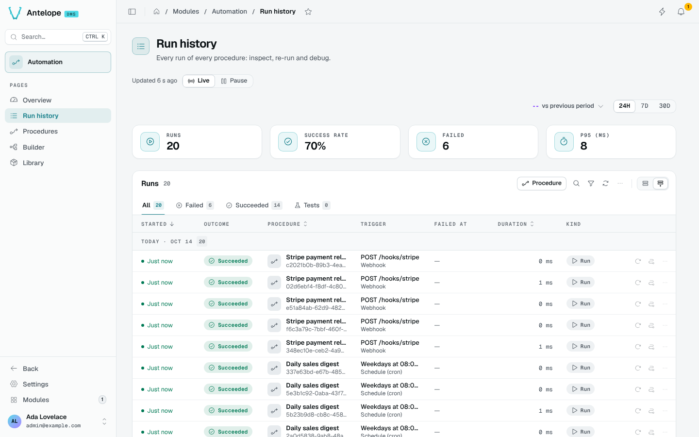
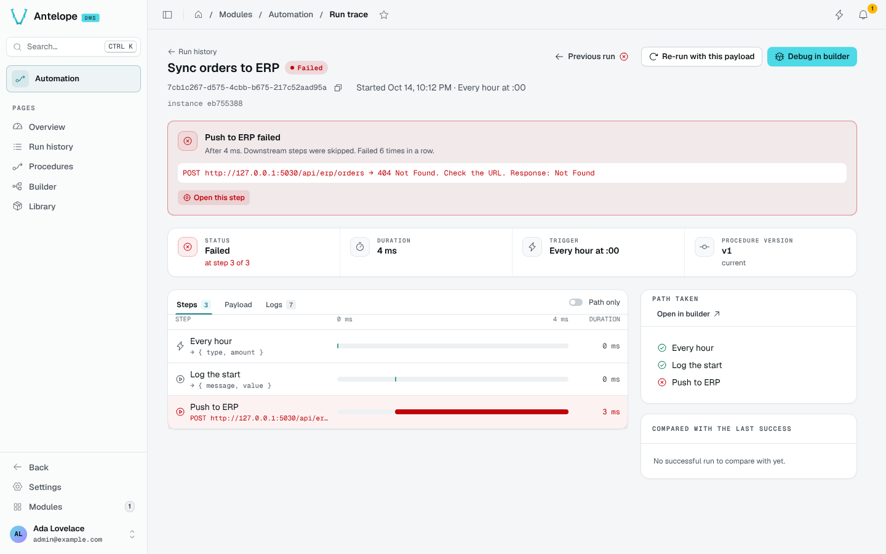

# Run history and trace

## Run history

The Run history (`/modules/automation/runs`) lists every run of every procedure, grouped by day, with the period's KPIs.

- The tabs filter on **Failed**, **Succeeded** and **Tests**; **Procedure** and the filters narrow the list.
- Each row shows the outcome, the procedure, the trigger, the step it failed at, the duration and the kind of run.
- One click opens a run in the side panel: its failure, the path taken, the payload and the log. `J` and `K` step through the runs.
- **Re-run** starts the procedure again with the run's own payload.
- A run is **Cancelled** when a module one of its steps belongs to stopped or reloaded while it ran. It is not a failure of the procedure: the health figures leave it out, and the **Status** filter lists these runs.

::note
A run keeps the request it received with credentials replaced by `[redacted]` (see `runs.sensitiveNames` in [Configuration](/docs/modules/automation/configuration)). A re-run therefore sends `[redacted]` in their place, and its confirmation says so.
::

## Run trace

The trace of a run (`/modules/automation/trace?run=<runId>`) is linkable, so a notification or a ticket can point at it.

- The failure card names the step that failed, after how long, how many times in a row, and its error. **Open this step** selects it.
- **Steps** lays every step on a time line with its output; **Payload** shows what the trigger received; **Logs** shows what each step logged.
- **Path taken** lists the steps the run went through; **Open in builder** shows the path on the graph.
- **Compared with the last success** shows what differs from the last run that succeeded.
- **Previous run**, **Re-run with this payload** and **Debug in builder** are in the header.
