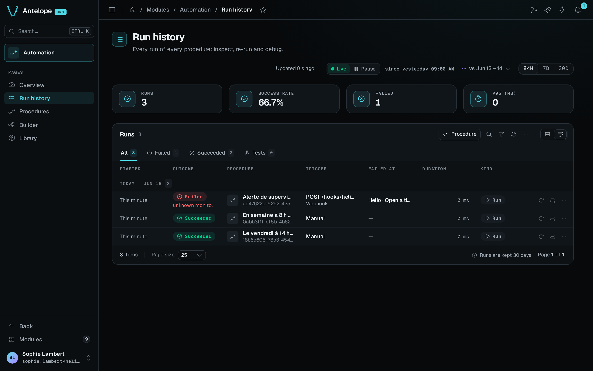
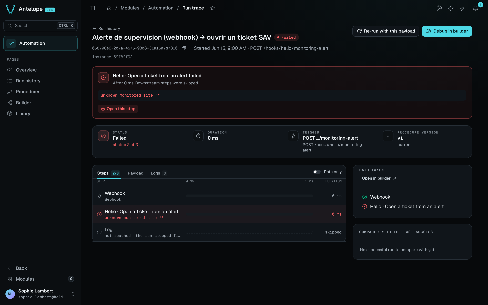

## Run history

The Run history (`/modules/automation/runs`) lists every run of every procedure, grouped by day, 25 to a page, with the period's figures above the list.

The bar at the top of the page holds the period and the **Live / Pause** switch. The period offers the same **24H**, **7D** and **30D** windows and the same comparisons as on the [Overview](/docs/modules/automation/usage/overview), and both pages share the choice. The four figures are **Runs**, **Success rate**, **Failed** and **p95 (ms)**, each with its change against the compared window.

Live, new runs come into the list and the figures as they are stored. The list also holds still while a run is open beside it or while you are scrolled down. **Pause** keeps the list and the figures still while you read. The list keeps its rows through a search, a sort or another page, and **N new · Show** counts the runs stored since.

- The tabs **Failed**, **Succeeded** and **Tests** filter the list. The **Procedure** filter and the column filters narrow it.
- **Search procedures, errors, steps, paths or run ids…** searches the list.
- Each row shows **Started**, **Outcome**, **Procedure**, **Trigger**, **Failed at**, **Duration** and **Kind** (**Run**, **Re-run** or **Test**). The column picker adds the run id, the trigger type, the error, the end time, the run it re-ran and the procedure version.
- **View runs** in the Procedures list opens the page on one procedure (`?procedure=<procedureId>`). A banner names the procedure, with **Show all runs** to go back to every run. The figures above still count every procedure.
- The footer says how long runs are kept: **Runs are kept 30 days** by default, **Runs are kept forever** with a `runs.retentionDays` of `0`, and **Older runs are deleted after the retention period set for this project** with any other value.

One click opens a run in a drawer on the right, titled with its procedure and its place in the list (**Run 4 of 50**). The drawer has three tabs. **Summary** holds the failure, the path taken and the steps. **Payload** holds what the trigger received, and **Logs** holds the log. `J` and `K` step through the runs, and the link keeps the open run (`?record=`). The buttons stay at the bottom of the drawer while its content scrolls: **Re-run with this payload** (an icon), **Open trace** and **Debug in builder**. Drag the drawer's inner edge to widen it. It opens again at that width.

The row menu has **Quick look**, which opens the same drawer, **Re-run** and **Open trace**.

## Re-run a run

**Re-run** runs the procedure's current saved graph with the original run's trigger and stored payload. It does not run a historical copy of the graph. A re-run of a test runs again the draft that test ran, and is stored as a test.

The confirmation, **Re-run with the same payload?**, warns that side effects are real. A re-run can send another email or repeat a write. Check the saved procedure, and whether repeating its actions is safe, before you confirm. A paused procedure still runs once.

The re-run is refused when:

- the procedure was deleted
- the trigger that started the run is no longer in the procedure
- the payload was too large to keep
- the run is a test whose draft was not kept

::note
A run keeps the request it received with credentials replaced by `[redacted]` (see `runs.sensitiveNames` in [Configuration](/docs/modules/automation/configuration)). A re-run therefore sends `[redacted]` in their place, and its confirmation says so.
::

## Run trace

The trace of a run (`/modules/automation/trace?run=<runId>`) can be linked, so a notification or a ticket can point at it.

- The header names the procedure, the run id and when and how the run started. **Previous run**, **Next run**, **Re-run with this payload** and **Debug in builder** sit beside it.
- The failure card names the step that failed, after how long, how many times in a row, and its error, with a link to the last success. **Open this step** opens the builder on that step.
- Four figures show the **Status** with the step reached, the **Duration** against the usual one, the **Trigger** and the **Procedure version**.
- **Steps** lays every step on a time line with its output. **Path only** keeps only the steps on the path the run took. **Payload** shows what the trigger received, and **Logs** shows what each step logged.
- **Path taken** lists the steps the run went through. **Open in builder** shows the path on the graph.
- **Compared with the last success** puts the time of each step next to the same step in the last run that succeeded, with the gap, and names the steps this run never reached.
- A banner says when the run used an older version of the procedure, and when the run is a re-run, with **Open the original run**.

For a test run, **Debug in builder** and **Open this step** are disabled. Their hint says that the builder opens the saved procedure, not the draft the test ran.
