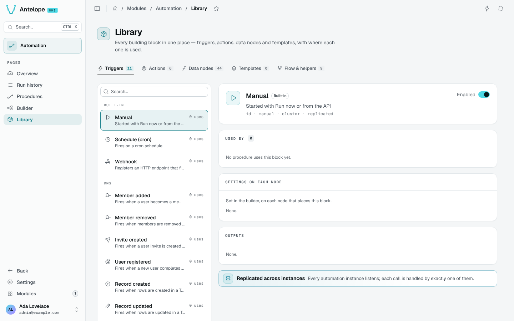

# Library

The Library (`/modules/automation/library`) gathers every building block in one place, with where each one is used.

The tabs are **Triggers**, **Actions**, **Data nodes**, **Templates** and **Flow & helpers**, with their counts. Entries are grouped by the module that registered them: built-ins first, then `dms`, then each module of the project.

Selecting an entry shows:

- its name, description, id and cluster mode (*replicated* or *singleton*);
- **Used by**: the procedures that use it;
- **Settings on each node**: the fields set in the builder on each node that places it;
- **Outputs**: what it hands to the next steps;
- an **Enabled** switch, to turn the type off for the whole project.

Webhook triggers show their full URL on the DMS `apiBaseUrl`. Templates open in the builder (`/modules/automation/builder?template=<id>`) to be edited, and list the procedures using them before a delete.
