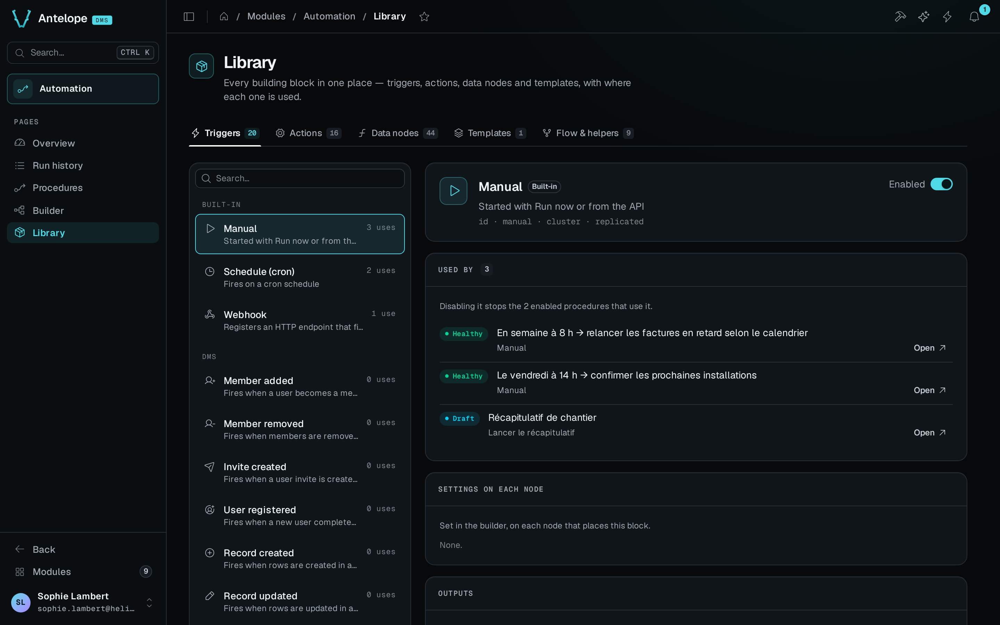

The Library (`/modules/automation/library`) gathers every building block in one place, with where each one is used.

The tabs are **Triggers**, **Actions**, **Data nodes**, **Templates** and **Flow & helpers**, with their counts. The link keeps the open tab. Entries are grouped by the module that registered them, built-ins first. Data nodes are also grouped by category, and flow blocks into **Flow** and **Helpers**. **Search…** filters the entries.

## Entry detail

Selecting a trigger, an action, a data node or a flow block shows these cards:

- its name, description and id, and the group it is listed under
- **Used by**, the procedures that use it, each with its state, where the node sits (in a group or through a template) and **Open** to open it in the builder
- **Settings on each node** for a trigger, the fields set in the builder on each node that places it
- **Inputs** for an action, a data node or a flow block, the fields it reads
- **Outputs**, what it hands to the next steps
- for a trigger, its cluster mode, also shown after its id, which is **Replicated across instances** (`replicated`), where every instance listens and one of them handles each call, or **Runs on one instance** (`singleton`), where only the leader runs it

Triggers and actions have an **Enabled** switch that turns the type off for the whole project. When enabled procedures use the type, **Used by** says how many of them disabling it stops, and **Disable** asks for confirmation. Steps of a disabled type fail when they run. Flow and helper blocks are built into the builder and cannot be switched off.

A webhook trigger shows the full URL of each use under **Used by**, built on the DMS `apiBaseUrl`. If outside services cannot reach that address, set `apiBaseUrl` in the DMS configuration.

## Templates

The **Templates** tab lists the templates saved from the builder, with how many places use each one. Selecting a template shows:

- **Details**, its name, description and icon, which **Save** stores
- **Ports**, with their name, direction, kind and type, edited inside the graph
- **Used in**, the procedures and templates that use it. Changes apply live to every one of them.

**Edit graph** opens the template in the builder (`/modules/automation/builder?template=<id>`). **Delete template** turns each use into a local group, so the procedures keep working. Its confirmation says how many places that changes.
